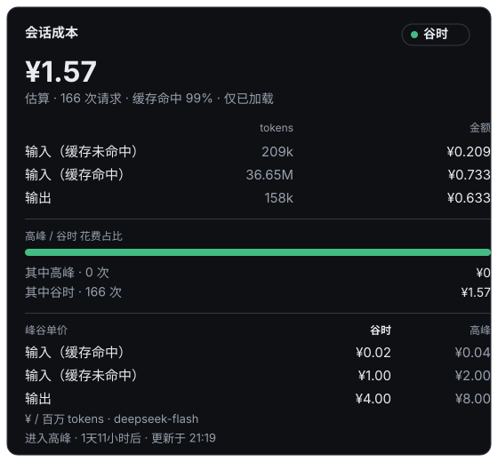

<div align="center">

# dsh-session-cost

**Know what this chat costs before the invoice does.**

Estimated spend, the peak/off-peak split, and the unit prices in force — on a flat card beside the conversation.

English | [中文](README.zh.md)




</div>

`dsh-session-cost` is a client plugin for [DeepSeek Harness](https://github.com/deepseek-ai/deepseek-harness). It folds the usage records a session already writes — one per model request — into money, and pins the result to the right of the chat: the ¥ total, a per-bucket ledger, the peak/off-peak split, and the price table that produced it. Double-click [`preview.html`](preview.html) to see the card without installing anything.

Harness already reports tokens: two composer pills count them and show the cache hit rate, and the Statistics tab breaks the same session down step by step. Neither answers "how much money is this", and neither tells you that the request you just sent bills at double because it landed at 14:05. Working that out today means opening the vendor price page, checking the clock, and multiplying by hand — for every request in the session.

## What you get

**Money instead of token counts.** Every usage record is priced at the tier and unit price that applied when it settled, so the big number is the one your invoice will roughly follow — you can watch a long agent run spend, without leaving the chat.

**The peak/off-peak split.** One segmented bar, then "peak · n requests" and "off-peak · m requests" with their own totals. A session that started at 08:50 and is still running at 14:10 shows you exactly how much of the bill sat in the expensive window.

**The current tier, and how long it lasts.** A badge says peak or off-peak; a countdown says when it flips. That is the input for the decision you actually make — start the big refactor now, or wait until 18:00.

**Both tiers side by side.** Cache hit, cache miss, and output, in an off-peak column and a peak column, with the live one emphasized. The 2× relationship and the 50× gap between cache hit and miss are visible instead of implied.

**A ledger that adds up.** Input (cache miss), input (cache hit), cache write, and output each show tokens and the amount actually billed for that bucket. Unit prices sit in their own table, so the columns never contradict each other.

**The cache hit rate next to the money.** Cache reads are 50× cheaper than misses on Flash, so the hit rate is the one number that explains a surprising total.

## Install

Requirements: DeepSeek Harness 0.2.2 or later (built and tested against 0.2.2-rc.3), desktop or web client. No build step, no runtime dependencies, no network access.

Clone the repository, then install the directory as a plugin bundle:

```sh
git clone https://github.com/menzi11/dsh-session-cost.git
```

**In the app:** Settings → Plugins → Add plugin → pick the cloned directory. Reload the page (Ctrl+R) once; the card appears at the top right of the conversation.

**Through an agent:** ask your DSH agent to install the bundle, or call the plugin manager with the directory path:

```text
plugin_manager install_bundle target=<absolute path to the clone>
```

**As a market source:** Settings → Plugins → Market sources → add

```text
https://raw.githubusercontent.com/menzi11/dsh-session-cost/main/market.json
```

The market index lists this package with commit-pinned install arguments. Market sources are an experimental surface in some builds; the local-directory route always works.

## How the number is made

The card reads the session's own event window: `data.usage` from each `assistant/message` (falling back to the last `usage` chunk in the stream) and each `assistant/attempt`. Usage is keyed by `turn:step`, so a retried attempt replaces its earlier sample instead of being counted twice. The model comes from the message's `source.model`, or from the latest `request/header` when the message does not carry one.

Off-peak list prices, CNY per 1M tokens; peak is exactly 2×:

| Model | Input (cache hit) | Input (cache miss) | Output |
|---|---|---|---|
| `deepseek-flash` | 0.02 | 1 | 4 |
| `deepseek-v4-pro` | 0.15 | 4.5 | 13.5 |

Peak is Monday–Friday 09:00–12:00 and 14:00–18:00 Asia/Shanghai; nights, weekends, and statutory holidays bill at the off-peak rate. `deepseek-v4-flash` and `deepseek-v4-flash-vision-exp` are served at Flash pricing; any other model name is priced as Flash and labelled as an assumption.

## Does it fit your setup?

- **Window, not whole log.** The card prices the events the client has loaded. A very long session shows "loaded history" next to the request count, and its total is a lower bound.
- **No holiday calendar.** Weekends are handled; the statutory holiday list is not, and the tier is taken from the settlement timestamp, so a request that straddles a boundary can be one tier off.
- **Prices are constants.** They live in `client.js` next to the tier rules; a vendor price change is an edit plus a page reload. No configuration, no settings page.
- **Placement is fixed.** Top right of the frame, 302px wide, on the page's base surface with a hairline border and no shadow. It does not move aside for the right sidebar.
- **An estimate, not an invoice.** The card says so.

## Development

```sh
node test/cost-helpers.test.mjs   # tier boundaries, retry de-duplication, bucket costs, formatting
```

The plugin has no build step: `client.js` is the browser bundle, loaded as-is by the Harness module loader. The pure accounting helpers live in its `pure-helpers` region and the test reads that region from the shipped file, so what is tested is what ships. `preview.html` mirrors the card's classes and CSS with demo data; add `?demo=mixed` to see a peak block and an off-peak block at once.

More detail — data path, limits, and how to read the numbers — is in [docs/DETAIL.md](docs/DETAIL.md).

## License

MIT © 2026 menzi11
