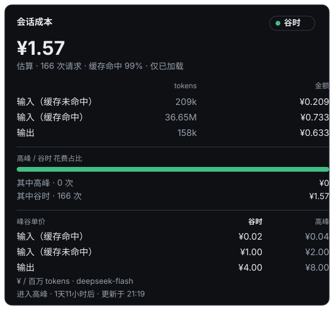

<div align="center">

# dsh-session-cost

**在账单之前，先看清这个会话花了多少。**

本会话估算花费、高峰与谷时的构成、以及正在生效的单价 —— 对话右侧一张平面卡片。

[English](README.md) | 中文




</div>

`dsh-session-cost` 是 [DeepSeek Harness](https://github.com/deepseek-ai/deepseek-harness) 的客户端插件。它把会话里本来就会写下、每个模型请求一条的 usage 记录折算成钱，固定显示在对话右侧：总额、逐桶账目、峰谷构成，以及产生这些数字的价目表。不想安装也能先看效果：双击 [`preview.html`](preview.html)。

Harness 本来就报 token：输入框下面两个胶囊给出 token 总量和缓存命中率，Statistics 面板还能逐步拆开。但它们都不回答“这是多少钱”，也不会告诉你刚发出的那次请求因为落在 14:05 而按双倍计费。今天要算清这件事，得打开厂商价格页、看一眼钟，再手乘一遍——而且每个请求一遍。

## 你会得到什么

**要钱，不要 token 数。** 每条 usage 都按它结算那一刻的档位与单价计价，所以那个大数字大致就是账单会走的方向——长任务跑着的时候，不用离开对话就能看到它在花钱。

**峰谷构成。** 一条分段条，下面分别是「高峰 · n 次」「谷时 · m 次」和各自的金额。08:50 开始、14:10 还在跑的会话，能直接看出多少账单落在贵的那一段。

**当前档位，以及还剩多久。** 徽标告诉你现在是高峰还是谷时，倒计时告诉你什么时候翻转。这正是你要做决定时缺的输入：大改现在动，还是等 18:00。

**两档单价并排。** 缓存命中、未命中、输出，谷时一列、高峰一列，当前档位加重。2 倍关系，以及命中与未命中之间 50 倍的价差，是看见的，不是猜的。

**一份对得上的账。** 未命中输入 / 命中输入 / 缓存写入 / 输出，每行给 tokens 和**该桶实际花掉的钱**；单价单独一张表，所以两处永远不会互相打架。

**把钱和缓存命中率放在一起。** Flash 上缓存命中是未命中的五十分之一价，所以命中率是最能解释“总额怎么这么低/这么高”的那个数。

## 安装

要求：DeepSeek Harness 0.2.2 及以上（在 0.2.2-rc.3 上构建与验证），桌面版或网页版客户端。无构建步骤、无运行时依赖、不联网。

先克隆仓库：

```sh
git clone https://github.com/menzi11/dsh-session-cost.git
```

**在应用里：** 设置 → 插件 → 添加插件 → 选中克隆下来的目录。然后刷新一次页面（Ctrl+R），卡片出现在对话右上角。

**让 Agent 装：** 直接让你的 DSH Agent 装这个目录，或调用插件管理器：

```text
plugin_manager install_bundle target=<克隆目录的绝对路径>
```

**作为市场源：** 设置 → 插件 → 市场源 → 添加

```text
https://raw.githubusercontent.com/menzi11/dsh-session-cost/main/market.json
```

索引里带的是 commit 锁定的安装参数。市场源在部分构建里还是实验性入口；本地目录那条路永远可用。

## 数字怎么来的

卡片读会话自己的事件窗口：每条 `assistant/message` 的 `data.usage`（缺失时回落到流里最后一个 `usage` chunk）和每条 `assistant/attempt`。usage 按 `turn:step` 归并，重试只会覆盖同一格的旧样本，不会重复计数。模型取消息的 `source.model`，消息没带时回落到最近的 `request/header`。

谷时单价，元 / 百万 tokens；高峰正好是 2 倍：

| 模型 | 输入（缓存命中） | 输入（缓存未命中） | 输出 |
|---|---|---|---|
| `deepseek-flash` | 0.02 | 1 | 4 |
| `deepseek-v4-pro` | 0.15 | 4.5 | 13.5 |

高峰 = 周一至周五 09:00–12:00、14:00–18:00（北京时间）；夜间、周末、法定节假日全按谷时。`deepseek-v4-flash` 与 `deepseek-v4-flash-vision-exp` 按 Flash 计价；其它模型名按 Flash 计价并标注为假设。

## 适合你的环境吗

- **只算窗口，不算整段日志。** 卡片只给已加载事件计价。超长会话会在请求数旁边标「仅已加载」，此时总额是下限。
- **没有节假日日历。** 周末已处理，法定节假日没有；档位取结算时间，跨 09:00 / 12:00 / 14:00 / 18:00 边界的请求可能差一档。
- **价目是常量。** 它们和档位规则一起放在 `client.js` 里，厂商调价就是改一处再刷新。没有配置项、没有设置页。
- **位置固定。** 右上角、302px 宽，用页面底色加一条描边分层，没有投影；右侧栏展开时不会让位。
- **是估算，不是账单。** 卡片自己写着这句。

## 开发

```sh
node test/cost-helpers.test.mjs   # 档位边界、重试去重、逐桶金额、格式化
```

插件没有构建步骤：`client.js` 就是浏览器 bundle，由 Harness 的模块加载器原样加载。纯计算函数放在它的 `pure-helpers` 区块里，测试直接从发布出去的那份文件里取这段，所以测的就是发布的。`preview.html` 用同一套 class 与 CSS 复刻卡片、配演示数据；加 `?demo=mixed` 能同时看到高峰段与谷时段。

数据来源、限制与数字口径的细节在 [docs/DETAIL.zh.md](docs/DETAIL.zh.md)。

## 许可证

MIT © 2026 menzi11
